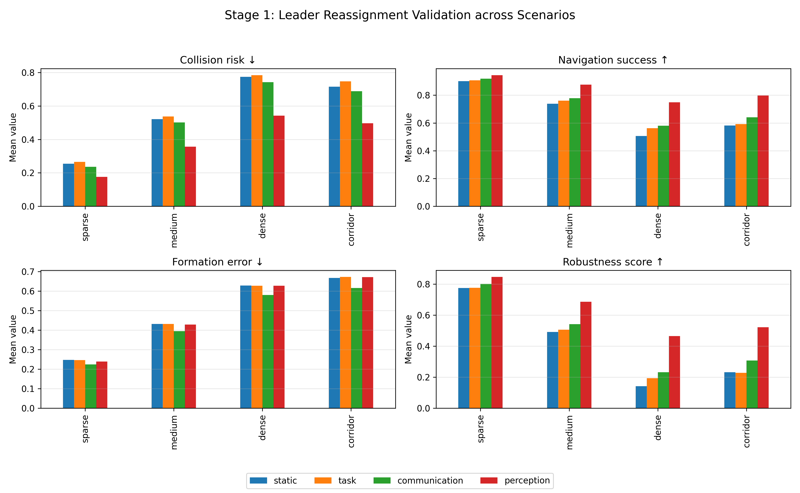
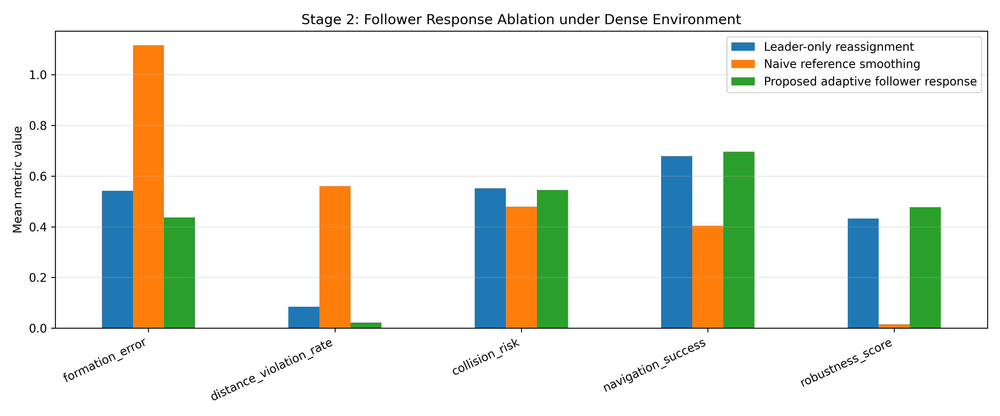

# Perception-Aware Multi-UAV Leader–Follower Coordination

**Durham University MSc dissertation project · Computer Vision and Robotics**  
**Author:** Yinzheng Cheng

Research code and simulation results for **perception-aware leader selection and adaptive follower formation control** in cluttered, unknown environments. The project tests whether incorporating local perception quality into leader reassignment improves team-level navigation and whether follower adaptation stabilizes formation after a switch.

> **Research scope:** The core experiments use an **abstract 2D multi-UAV simulation**. This repository is **not** a hardware flight-control stack, a complete visual SLAM implementation, or evidence of real-world UAV deployment.

## Research overview / 项目简介

This project compares four leader-selection strategies—**static**, **task-based**, **communication-based**, and **perception-aware**—under sparse, medium, dense, and corridor-like obstacle conditions. A second group of experiments compares the follower-side response after leader switching, including **leader-only**, **naive smoothing**, and an **adaptive response**.

本项目研究复杂环境中多无人机编队的动态领航者切换与跟随者自适应编队控制，重点验证感知质量、通信质量和几何适用性联合决定领航者的效果，并比较领航者切换后不同跟随策略的编队稳定性。实验采用抽象二维仿真，并非真实无人机飞行验证。

### Core method

- Leader score based on **perception quality, communication quality, and geometric suitability**, with a switching threshold to reduce oscillations.
- Adaptive follower behavior incorporating **reference smoothing, velocity synchronization, formation recovery, and inter-UAV spacing regulation**.
- Baseline comparisons, parameter/threshold sensitivity studies, ablation tests, and trial-level quantitative reporting.

## Selected simulation results

The figures below are generated from this project's simplified simulation. Reported values are simulation-specific and should not be interpreted as guaranteed real-world performance.





Key tables (CSV):

- [Stage 1 — leader strategies](integrated_uav_results/tables/paper_table_stage1_leader_validation.csv)
- [Stage 2 — follower ablation](integrated_uav_results/tables/paper_table_stage2_follower_ablation.csv)
- [Summary of selected comparisons](integrated_uav_results/tables/paper_level_key_results_summary.csv)

## Repository structure

```text
.
├── integrated_multi_uav_leader_follower_validation.ipynb  # Main two-stage validation
├── multi_scenario_validation_statistics.ipynb            # Multi-scenario statistical tests
├── follower_formation_response_ablation_v2.ipynb         # Updated follower experiment
├── follower_formation_response_ablation.ipynb            # Initial follower ablation
├── multi_uav_modeling_notebook.ipynb                     # Early system modeling
├── perception_aware_uav_experiment_analysis.ipynb        # Strategy exploration
├── uav_formation_visualization_notebook.ipynb           # Static visualizations
├── uav_formation_visualization_with_animation.ipynb     # Generates animations
├── integrated_uav_results/                              # Main results, plots, CSVs
├── multi_scenario_results/                              # Trial and sensitivity statistics
├── follower_response_results/                           # Follower ablation outputs
├── follower_response_v2_results/                        # Updated ablation outputs
├── figure_visualization/                                # Selected visual summaries
├── figure/                                              # Additional overview plots
└── requirements.txt
```

## Getting started

Requires **Python 3.10+** and Jupyter Notebook / JupyterLab. Run commands from this **project directory** (`dissertation/multi-uav-coordination/`):

```bash
python -m venv .venv
# Windows PowerShell: .venv\Scripts\Activate.ps1
# macOS / Linux:
source .venv/bin/activate
python -m pip install -r requirements.txt
jupyter lab
```

Open **`integrated_multi_uav_leader_follower_validation.ipynb`** and run cells top-to-bottom for the main experiment. Other notebooks contain supporting analysis and visualizations. Some notebooks write plots/CSV outputs into their corresponding `*_results/` directories.

**Reproducibility notes:** Notebook code and a selection of output figures/CSVs are retained, but stored execution outputs were cleared to keep the repository lightweight. Animation HTML files are intentionally excluded due to size and can be regenerated from the visualization notebook. Results can vary by Python package versions and sampling settings.

## Limitations

- 2D simulation with abstracted perception and low-level control, not a photorealistic drone simulation.
- Obstacle sensing and communication scores are modeled at the coordination-decision layer.
- Hardware integration, complete visual SLAM, and deployment validation remain future work.
- Specific simulation scenarios may exhibit low absolute navigation success even when an approach improves over its baselines.

## Publication and reuse

This repository contains code and research results from an MSc project. **No open-source license has been assigned**; contact the author before reusing or redistributing the code. A manuscript was omitted from this code package pending the author's decision about public release.
